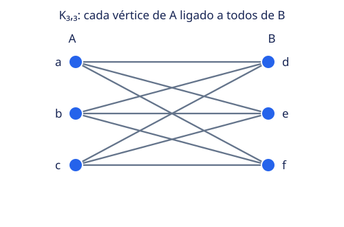
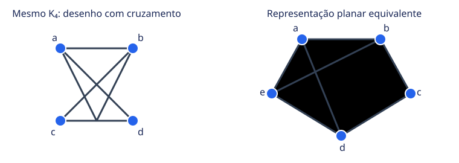
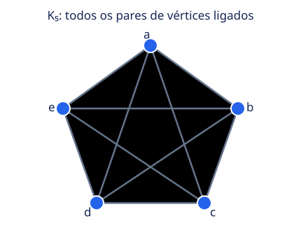
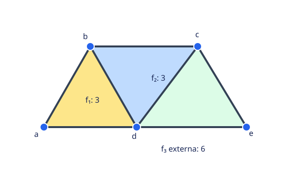
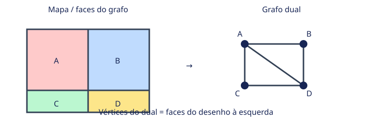
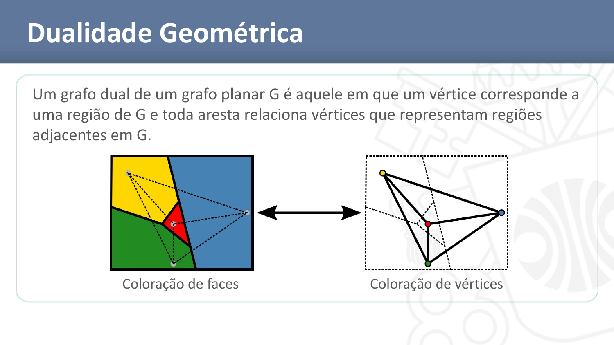
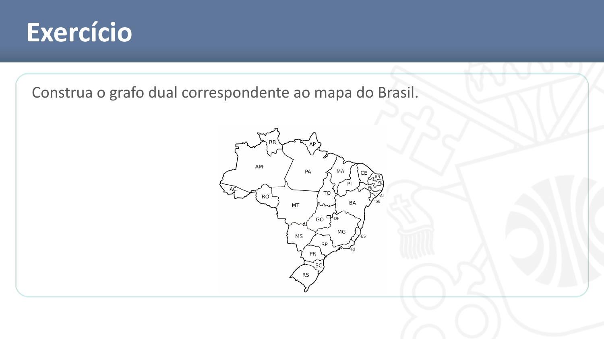
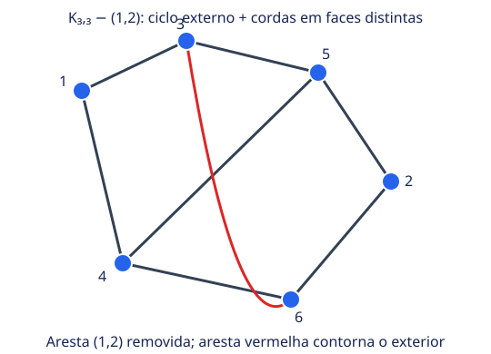

# Planaridade em Grafos

> Apostila de estudo baseada nos 37 slides da aula **21 - Planaridade em Grafos** (Prof. Luiz Henrique). Os diagramas vetoriais recriam as ideias dos slides para deixar vértices, arestas e regiões legíveis. As imagens dos slides sobre coloração, dualidade e o exercício do mapa do Brasil foram preservadas em `assets/planaridade/`.

## Sumário

1. [Introdução à planaridade](#1-introdução-à-planaridade-em-grafos)
2. [Três casas e três serviços](#2-modelagem-do-problema-das-três-casas-e-três-serviços-públicos)
3. [O que é um grafo planar?](#3-o-que-é-um-grafo-planar)
4. [Exemplos planares](#4-grafos-planares-exemplos)
5. [Exemplos não planares](#5-grafos-não-planares-exemplos)
6. [Kuratowski: K₅ e K₃,₃](#6-grafos-de-kuratowski-k₅-e-k₃₃)
7. [Aplicações](#7-aplicações-da-planaridade)
8. [Faces](#8-faces-de-um-grafo-planar)
9. [Grau de uma face](#9-grau-de-uma-face)
10. [Soma dos graus das faces](#10-relação-entre-o-número-de-arestas-e-o-grau-das-faces)
11. [Fórmula de Euler](#11-fórmula-de-euler)
12. [Coloração de faces](#12-coloração-de-faces)
13. [Dualidade geométrica](#13-dualidade-geométrica)
14. [Teorema das quatro cores](#14-teorema-das-quatro-cores)
15. [Exercícios dos slides](#15-resolução-detalhada-dos-exercícios-dos-slides)
16. [Revisão rápida](#16-resumo-geral-para-revisão-da-prova)

---

## 1. Introdução à planaridade em grafos

Um **grafo** representa objetos e relações: pontos chamados **vértices** representam os objetos, e linhas chamadas **arestas** representam as relações entre pares de objetos. A planaridade pergunta se é possível desenhar essas relações em uma folha plana sem que duas linhas se cruzem em um ponto que não seja um vértice.

O desenho é importante, mas não é o próprio grafo. Podemos mover os vértices e curvar as arestas. Assim, um desenho confuso pode esconder uma representação plana simples. A pergunta correta é sempre: **existe algum desenho sem cruzamentos?**

**Exemplo:** em um diagrama de uma rede, cruzamentos podem ser apenas consequência de como posicionamos os pontos. Se podemos reposicionar tudo e remover os cruzamentos sem mudar quais pares estão ligados, o grafo é planar.

**Atenção na prova:** um cruzamento visual não prova não planaridade. Já os cruzamentos inevitáveis em *toda* representação são o que caracteriza a dificuldade.

## 2. Modelagem do problema das três casas e três serviços públicos

O enunciado clássico dos slides pede ligar cada uma de três casas a cada um de três serviços — água, eletricidade e esgoto — sem cruzamento das tubulações.

Para modelar:

1. Crie um vértice para cada casa e um para cada serviço.
2. Ligue cada casa a cada serviço com uma aresta.
3. Pergunte se esse grafo tem uma representação planar.

O grafo é **bipartido completo** (K_{3,3}): os vértices se dividem em dois grupos de três (casas e serviços), e cada vértice de um grupo liga-se a todos os do outro grupo. Há (3\cdot3=9) ligações.

O desenho acima deixa claras as nove ligações, mas elas se cruzam. O ponto essencial é que não existe outra disposição no plano que elimine todos os cruzamentos mantendo as nove ligações: (K_{3,3}) é não planar. Logo, as três casas não conseguem ser ligadas aos três serviços em uma única superfície plana sem cruzamentos.

**Erro comum:** tentar provar a impossibilidade só com um desenho. Uma figura cruzada não basta; a justificativa deve usar um resultado (por exemplo, a cota planar para grafos bipartidos) ou um argumento estrutural.

## 3. O que é um grafo planar?

**Definição:** um grafo (G=(V,E)) é **planar** se existe pelo menos uma representação gráfica de (G) no plano sem cruzamento de arestas. Uma representação específica sem cruzamentos é chamada **grafo plano** nos slides.

- (V): conjunto de vértices.
- (E): conjunto de arestas, cada uma ligando um par de vértices.
- “Existe”: basta encontrar uma representação sem cruzamentos.
- “Sem cruzamento”: duas arestas só podem se encontrar em uma extremidade que seja vértice comum.

Não se exige que as arestas sejam retas. Elas podem ser curvas, desde que não se cruzem fora dos vértices.

Ambos os desenhos representam (K_4), pois têm os mesmos quatro vértices e as mesmas seis arestas. O desenho da esquerda tem cruzamentos, mas o da direita prova que (K_4) é planar.

**Por que importa:** a planaridade permite entender como organizar uma rede ou um mapa sem interseções e leva a relações fortes entre vértices, arestas e regiões (faces).

## 4. Grafos planares: exemplos

Os slides ilustram ciclos (C_3,C_4), caminhos (P_2,P_3), (K_{2,3}), uma roda (W_5) e uma árvore (T). Todos admitem desenhos sem cruzamentos. Caminhos e árvores, em particular, podem ser desenhados sem ciclos; não cercam regiões internas.

Um exemplo concreto é (K_4), o grafo completo de quatro vértices. Cada vértice está ligado aos outros três; apesar de seis arestas, ele pode ser desenhado como um triângulo com um vértice no interior ligado aos três vértices do contorno.

**Dica:** para verificar se um desenho cruzado representa um grafo planar, ignore a posição atual dos pontos e procure uma nova disposição. Não é necessário manter comprimentos, ângulos ou formato das arestas.

## 5. Grafos não planares: exemplos

Os exemplos centrais dos slides são (K_5) e (K_{3,3}). O fato de todos os desenhos usuais apresentarem cruzamentos é uma pista; a prova pode ser feita por contagem, como veremos na seção de Kuratowski.

**Atenção:** não confunda “este desenho tem cruzamento” com “o grafo é não planar”. A segunda afirmação exige descartar *todas* as representações possíveis.

## 6. Grafos de Kuratowski: K₅ e K₃,₃

Os slides chamam (K_5) e (K_{3,3}) de **grafos de Kuratowski**. Ambos são regulares: em (K_5) cada vértice tem grau 4; em (K_{3,3}), grau 3.

| Grafo | Estrutura | Vértices (n) | Arestas (m) | Grau de cada vértice |
|---|---|---:|---:|---:|
| (K_5) | completo: todo par de vértices é ligado | 5 | 10 | 4 |
| (K_{3,3}) | bipartido completo, grupos 3 e 3 | 6 | 9 | 3 |

### Por que não são planares?

**Complemento didático — cotas derivadas de Euler.** Para um grafo planar simples conexo com (n\ge3), cada face tem grau pelo menos 3. Como a soma dos graus das faces é (2m) e (n-m+f=2), temos (3f\le2m), portanto (m\le3n-6). Para um grafo bipartido simples, não há ciclos ímpares e cada face tem grau pelo menos 4; daí (4f\le2m) e (m\le2n-4).

- (K_5): a cota planar dá (m\le3(5)-6=9), mas (K_5) tem 10 arestas. Contradição.
- (K_{3,3}): usando a cota bipartida, (m\le2(6)-4=8), mas tem 9 arestas. Contradição.

Logo ambos são não planares.

Os slides também observam que **remover uma aresta ou um vértice** de qualquer um deles torna o grafo planar. Em particular, (K_5) é o grafo não planar com menor número de vértices, e (K_{3,3}), o não planar com menor número de arestas (entre os grafos simples relevantes ao curso).

**Complemento:** o Teorema de Kuratowski, em sua forma clássica, caracteriza grafos planares pela ausência de subdivisões de (K_5) e (K_{3,3}). A aula usa os dois grafos como exemplos fundamentais; a caracterização completa é um resultado adicional.

## 7. Aplicações da planaridade

Os slides destacam três usos:

- **Circuitos eletrônicos:** verificar se as ligações podem ser desenhadas em um plano sem cruzamentos, o que facilita a fabricação e pode reduzir interferências.
- **Redes de transporte:** planejar rotas urbanas minimizando interseções.
- **Análise e desenho de grafos:** decidir se uma rede pode ser representada sem cruzamentos.

**Exemplo:** se componentes de um circuito são vértices e conexões são arestas, um desenho plano significa que as conexões podem ocupar uma camada sem cruzar umas às outras. Circuitos reais podem usar camadas diferentes; isso é uma extensão prática além do modelo plano simples.

## 8. Faces de um grafo planar

**Definição:** uma representação planar divide o plano em regiões chamadas **faces**. Uma delas é ilimitada e recebe os nomes **face infinita** ou **face externa**; as demais são internas.

Na figura, as duas regiões coloridas no alto são internas. A região verde é externa: ela se estende indefinidamente para fora do desenho. O contorno não precisa ser um ciclo simples; pode percorrer uma aresta duas vezes quando essa aresta é uma ponte.

Para um grafo planar conexo, o número de faces é o mesmo em qualquer representação plana, pois depende de (n) e (m) pela fórmula de Euler. Um mesmo grafo pode mudar de aparência, mas não esse número.

**Atenção na prova:** a face externa também conta. Não conte apenas as regiões “dentro” de um desenho.

## 9. Grau de uma face

**Definição:** o grau (d(f)) de uma face (f) é o número de arestas no passeio fechado que percorre sua fronteira. Conta-se a ocorrência de cada aresta no passeio, e não apenas quantas arestas distintas aparecem.

Na figura acima:

- (f_1) tem fronteira (a\to b\to d\to a), então (d(f_1)=3).
- (f_2) tem fronteira (b\to c\to d\to b), então (d(f_2)=3).
- A face externa (f_3) percorre (a\to b\to c\to d\to e\to d\to a), então (d(f_3)=6).

A aresta (de) é uma ponte: ela não separa duas faces diferentes. O passeio da face externa precisa percorrê-la para ir até (e) e voltar, por isso aparece duas vezes.

**Erro comum:** contar uma aresta de ponte apenas uma vez. A contagem do grau é um passeio fechado e registra as duas passagens.

## 10. Relação entre o número de arestas e o grau das faces

Para qualquer grafo plano, a soma dos graus das faces satisfaz

\[
\sum_{f\in F}d(f)=2m.
\]

**Por que aparece o 2?** Cada aresta tem dois lados. Ao percorrer os contornos das faces, cada lado é contabilizado uma vez. Se a mesma face fica dos dois lados de uma ponte, a aresta é contada duas vezes na fronteira dessa face.

**Exemplo resolvido:** a figura anterior tem (m=6) arestas. Os graus são 3, 3 e 6. Logo

\[
3+3+6=12=2\cdot6.
\]

Além de conferir a conta, essa igualdade ajuda a perceber contagens erradas de fronteiras.

## 11. Fórmula de Euler

Para um **grafo planar conexo** com (n) vértices, (m) arestas e (f) faces:

\[
n-m+f=2.
\]

- (n=|V|): quantidade de vértices.
- (m=|E|): quantidade de arestas.
- (f): quantidade de faces, incluindo a face externa.

Isolando (f):

\[
f=m-n+2.
\]

**Intuição da relação:** uma árvore conexa tem (m=n-1) e apenas a face externa, então (n-(n-1)+1=2). Ao acrescentar uma aresta que fecha um ciclo em um desenho plano, ela cria uma face nova: (m) e (f) aumentam juntos, mantendo (n-m+f) constante.

### Exercício resolvido 1

Um grafo planar conexo tem 8 vértices e 12 arestas. Quantas faces possui?

\[
f=m-n+2=12-8+2=6.
\]

**Resposta:** 6 faces, contando a externa.

### Exercício resolvido 2

Um grafo planar conexo tem 7 vértices e 9 faces. Quantas arestas possui?

Partimos de (n-m+f=2) e isolamos (m):

\[
m=n+f-2=7+9-2=14.
\]

**Resposta:** 14 arestas.

**Atenção:** nos slides a fórmula é enunciada para grafos planares conexos. Não a aplique sem ajuste a um grafo desconexo. Para (c) componentes, a relação correspondente é (n-m+f=1+c).

## 12. Coloração de faces

**Colorir faces** é atribuir uma cor a cada região de modo que faces adjacentes tenham cores diferentes. Adjacentes são faces que compartilham um trecho de fronteira; encontrar-se somente num vértice não as torna adjacentes nessa definição usual de mapas.

À esquerda, cada região do mapa recebe cor. À direita, cada região vira um vértice, e uma aresta indica que as duas regiões compartilham fronteira: assim, colorir regiões se converte em colorir vértices do grafo dual.

| Coloração de vértices | Coloração de faces |
|---|---|
| Cada vértice recebe uma cor. | Cada região recebe uma cor. |
| Vértices ligados por aresta devem diferir. | Faces que compartilham fronteira devem diferir. |

O problema do mapa brasileiro no slide mostra a motivação original: estados são regiões, e estados vizinhos precisam de cores diferentes.

## 13. Dualidade geométrica

**Definição:** dado um desenho planar de (G), o grafo dual (G^*) tem um vértice para cada face de (G). Para cada aresta original que separa duas faces, adiciona-se uma aresta entre os vértices duais correspondentes.

Construção passo a passo:

1. Fixe uma representação plana do grafo (o dual depende desse desenho).
2. Marque um ponto dentro de cada face; esse ponto será um vértice do dual.
3. Para cada fronteira compartilhada por duas faces, trace uma aresta dual atravessando essa fronteira uma vez e ligando os pontos dessas faces.
4. Remova o desenho original: ficam os vértices-faces e suas adjacências.

O esquema da seção anterior mostra um mapa à esquerda e suas adjacências à direita. Uma ponte tem a mesma face em ambos os lados; no dual, ela pode gerar um laço. Se duas faces compartilham mais de uma aresta, o dual pode ter arestas paralelas.

### Exercício dos slides: dual do mapa do Brasil

O procedimento é: criar um vértice para cada unidade federativa (incluindo o Distrito Federal), depois unir dois vértices exatamente quando os estados compartilham uma fronteira de comprimento positivo. A imagem do slide fornece o mapa base; não se liga estados que só se encontram num ponto.

**Lista de adjacências para conferir o desenho** (divisas estaduais terrestres; ilhas costeiras não contam):

| UF | Vizinhos |
|---|---|
| AC | AM, RO |
| AL | BA, PE, SE |
| AP | PA |
| AM | AC, MT, PA, RO, RR |
| BA | AL, ES, GO, MG, PE, PI, SE, TO |
| CE | PB, PE, PI, RN |
| DF | GO |
| ES | BA, MG, RJ |
| GO | BA, DF, MG, MS, MT, TO |
| MA | PA, PI, TO |
| MT | AM, GO, MS, PA, RO, TO |
| MS | GO, MG, MT, PR, SP |
| MG | BA, ES, GO, MS, RJ, SP |
| PA | AP, AM, MA, MT, RR, TO |
| PB | CE, PE, RN |
| PR | MS, SC, SP |
| PE | AL, BA, CE, PB, PI |
| PI | BA, CE, MA, PE, TO |
| RJ | ES, MG, SP |
| RN | CE, PB |
| RS | SC |
| RO | AC, AM, MT |
| RR | AM, PA |
| SC | PR, RS |
| SP | MG, MS, PR, RJ |
| SE | AL, BA |
| TO | BA, GO, MA, MT, PA, PI |

Cada adjacência aparece em duas linhas porque a relação é simétrica. O dual tem 27 vértices. Ao desenhá-lo, organize os vértices aproximadamente como no mapa para manter as arestas legíveis; a forma do desenho pode variar, mas o conjunto de adjacências não.

## 14. Teorema das quatro cores

**Enunciado:** qualquer mapa plano dividido em regiões pode ser colorido com no máximo quatro cores, de modo que regiões vizinhas não tenham a mesma cor. Pelo dual, isso equivale a dizer que os vértices de qualquer grafo planar podem ser coloridos com quatro cores.

Os slides registram o contexto histórico: a suficiência de cinco cores era conhecida desde 1800; o teorema das quatro cores foi provado em 1976 por Appel e Haken. Em 1997, Robertson, Sanders, Seymour e Thomas publicaram uma prova mais simples, ainda com ideias computacionais, para dissipar dúvidas remanescentes sobre a prova anterior.

O teorema garante que **quatro bastam**, não que todo mapa precise de quatro. Muitos mapas precisam de menos.

## 15. Resolução detalhada dos exercícios dos slides

### Exercício 1 — grafo de seis vértices

**Enunciado.** Considere

\[
V=\{1,2,3,4,5,6\},\\
E=\{(1,2),(1,3),(1,4),(2,5),(2,6),(3,5),(3,6),(4,5),(4,6)\}.
\]

a) Tente desenhar sem cruzamentos. b) O grafo é planar? c) Se for planar, quantas faces tem? Caso contrário, remova o mínimo de arestas para torná-lo planar e determine o número de faces.

**Passo 1: reconhecer a estrutura.** Separe os vértices em (A=\{1,5,6\}) e (B=\{2,3,4\}). Cada vértice de (A) liga-se a cada vértice de (B), portanto o grafo é (K_{3,3}). Tem (n=6), (m=9), e não é planar.

Uma confirmação numérica: se fosse planar, por ser bipartido simples teríamos (m\le2n-4=8). Mas (m=9). Impossível.

**Passo 2: mínimo de remoções.** Zero remoções não basta, pois (K_{3,3}) é não planar. Uma remoção basta: retirar ((1,2)) produz (K_{3,3}-(1,2)), que admite o desenho abaixo. Portanto o mínimo é **uma aresta**.

No desenho, o ciclo externo percorre (1,3,5,2,6,4,1). As duas arestas que faltam para completar o (K_{3,3}-(1,2)) são ((5,4)) e ((6,3)); uma fica desenhada no interior e a outra contorna o exterior. Elas não se cruzam.

**Passo 3: faces após a remoção.** Agora (n=6), (m=8), conexo e planar. Euler dá

\[
f=m-n+2=8-6+2=4.
\]

**Resposta:** o grafo original não é planar; é preciso remover no mínimo uma aresta; após essa remoção, a representação tem 4 faces (3 internas e a externa).

**Conceitos cobrados:** reconhecer (K_{3,3}), testar não planaridade com a cota bipartida, construir a versão com uma aresta a menos e contar faces por Euler.

### Exercício 2 — desenhar um mapa correspondente a (K_4)

**Enunciado:** desenhe um mapa qualquer correspondente a (K_4).

Na dualidade, um vértice do grafo corresponde a uma região do mapa, e duas regiões compartilham fronteira quando os vértices correspondentes são adjacentes. Use uma representação planar de (K_4): triângulo externo (a,b,c), vértice (d) no interior, e arestas (ab,bc,ca,ad,bd,cd). As quatro faces desse desenho podem ser tratadas como as quatro regiões do mapa dual; o dual de (K_4) também é (K_4). Assim, cada par das quatro regiões é vizinho.

Ao passar do grafo para o mapa, use as faces como regiões e marque em cada região o vértice correspondente do dual. O desenho à direita do SVG fornece uma forma plana do (K_4); para visualizar o mapa com quatro países, pense nas quatro faces (incluindo a externa) como os países.

**Conceito cobrado:** relação entre uma representação plana, suas faces e o grafo dual.

### Exercício 3 — construir o dual do mapa do Brasil

**Enunciado:** construa o grafo dual correspondente ao mapa do Brasil.

Cada estado (mais o DF) vira um vértice. Ligue dois vértices se, e somente se, os estados correspondentes compartilham fronteira. O mapa do slide e a lista de adjacências da seção [Dualidade geométrica](#13-dualidade-geométrica) especificam a construção completa: transcreva cada vizinhança como uma aresta não direcionada e desenhe os vértices na posição aproximada dos estados.

**Como conferir:** nenhuma aresta deve existir entre estados não vizinhos; cada vizinhança listada deve aparecer como uma aresta; cada aresta deve aparecer uma única vez no desenho (a lista é simétrica). Não conte estados que apenas se encontram em um ponto como vizinhos.

**Conceito cobrado:** transformar regiões geográficas e suas fronteiras em vértices e arestas.

## 16. Resumo geral para revisão da prova

### Revisão rápida para a prova

| Conceito | Definição / fórmula | O que saber fazer |
|---|---|---|
| Grafo planar | Admite alguma representação sem cruzamentos | Distinguir grafo planar de desenho plano específico |
| Face | Região do plano delimitada por arestas | Contar também a face externa |
| Grau da face | Arestas no passeio fechado da fronteira | Contar repetições, inclusive pontes duas vezes |
| Soma dos graus das faces | \(\sum_f d(f)=2m\) | Conferir grau total e explicar o fator 2 |
| Euler (conexo planar) | \(n-m+f=2\), logo \(f=m-n+2\) | Calcular a variável ausente |
| (K_5) | 5 vértices, 10 arestas, completo | Usar \(m\le3n-6\) para provar não planaridade |
| (K_{3,3}) | Dois grupos de 3, 9 arestas | Usar \(m\le2n-4\) para grafos bipartidos planares |
| Coloração de faces | Faces que compartilham fronteira recebem cores distintas | Traduzir o problema para coloração do dual |
| Grafo dual | Um vértice por face; arestas representam adjacência | Construir vértices e conexões a partir do mapa |
| Quatro cores | Quatro cores bastam para qualquer mapa plano | Entender adjacência e não exigir sempre quatro cores |

### Fórmulas para memorizar

\[
\sum_{f\in F}d(f)=2m,\qquad n-m+f=2,\qquad f=m-n+2.
\]

Para provar não planaridade em exemplos simples, também são úteis as cotas complementares derivadas de Euler:

\[
m\le3n-6\quad\text{(planar simples, }n\ge3\text{)},\qquad
m\le2n-4\quad\text{(planar bipartido simples).}
\]

### Erros comuns

1. Declarar um grafo não planar porque um desenho particular cruza.
2. Esquecer a face externa ao contar (f).
3. Contar uma ponte uma só vez no grau da face.
4. Aplicar Euler sem verificar que o grafo é planar e conexo.
5. Confundir colorir os vértices com colorir as faces.
6. No grafo dual, ligar regiões que apenas se tocam num ponto, sem compartilhar fronteira.
7. Tratar (K_5) e (K_{3,3}) como se tivessem a mesma estrutura: (K_5) é completo e não bipartido; (K_{3,3}) é bipartido completo.

### Checklist para resolver uma questão

1. Identifique (n), (m), conexidade e, se houver, a bipartição.
2. Separe o grafo de um desenho específico: procure outra representação antes de concluir.
3. Para faces, marque primeiro a região externa e percorra cada fronteira com cuidado.
4. Use Σ graus das faces (=2m) como verificação.
5. Use Euler somente no caso planar conexo e conte a face externa.
6. Para um dual, crie um vértice por região e conecte apenas regiões que compartilham uma aresta de fronteira.

---

**Fonte principal:** slides da aula *21 - Planaridade em Grafos*. Os resultados explicitamente assinalados como “complemento didático” foram incluídos para fundamentar as demonstrações e estão separados do conteúdo histórico/descritivo dos slides.
